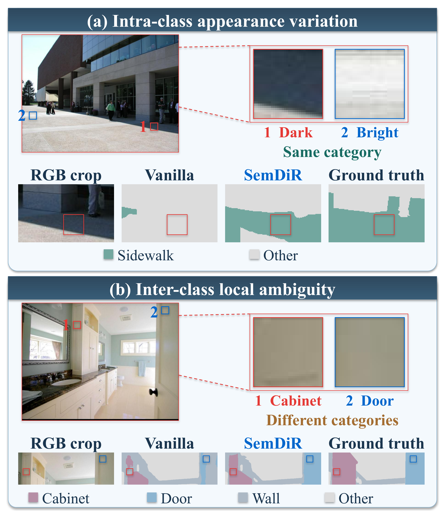
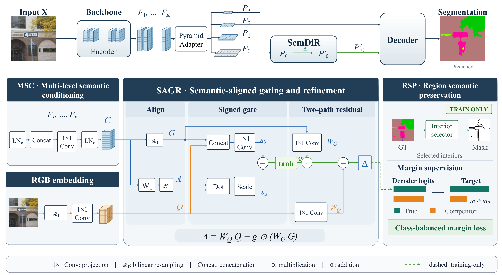
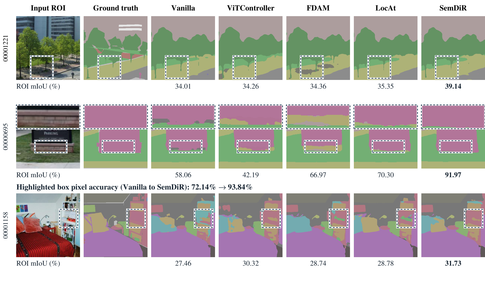

# SemDiR: Compact Semantic Context for Fine-Grid Refinement

**English** | [简体中文](README_zh-CN.md)

SemDiR addresses local label ambiguity in semantic segmentation by inserting a compact semantic refinement module between an existing feature pyramid and its decoder. The full implementation, **SemDiR-A2 = MSC + SAGR + RSP**, aggregates multi-level semantics, uses local RGB information to modulate signed semantic corrections, and strengthens category discrimination with training-only region-interior supervision.

This repository includes source code, experiment configurations, required dependency sources, licenses, and the paper's presentation figures and main table. Datasets, pretrained weights, trained checkpoints, and complete experiment logs are not included. Results below are reported in the current manuscript; this code packaging work did not retrain models or independently validate performance.

## Motivation: local appearance can be ambiguous



**Figure 1.** Appearance can vary within a category or resemble that of another category. The selected examples show dark/bright sidewalk regions and a cabinet/door with similar local appearance. SemDiR agrees with the annotations in the highlighted regions. [Original PDF](assets/figure1_motivation.pdf)

## Method: compact semantic context for fine-grid refinement



**Figure 2.** MSC compresses multi-level semantic features on the coarse grid. SAGR aligns them with local RGB information, modulates semantic corrections through a signed spatial gate, and adds an independent RGB update. Only the finest pyramid feature is refined. RSP adds class-balanced margin supervision to selected region interiors during training. [Original PDF](assets/figure2_framework.pdf)

## Qualitative results



**Figure 3.** Three selected ADE20K regions using DeiT-S/16 checkpoints at 160K iterations. Columns show input, ground truth, Vanilla, ViTController, FDAM, LocAt, and SemDiR; matched boxes identify the same positions. Numbers below predictions are whole-ROI mIoU; the pixel-accuracy annotation in row two applies only to the highlighted box. One diagnostic checkpoint is used per method; cases and windows are selected. [Original PDF](assets/figure3_results.pdf)

## Main results: ADE20K at 160K iterations

Accuracy values are means over seeds 0, 1, and 2. SS/MS denote single-/multi-scale evaluation; bold marks the best accuracy within each backbone. Parameters include auxiliary heads; M/G denote million/billion. FLOPs count supported operators for a 512 × 2048 input, with one multiply-add counted as one operation. Competitor results are local adaptations; Vanilla excludes SemDiR.

| Backbone | Method | Params (M) | FLOPs (G) | mIoU SS (%) | mIoU MS (%) | mAcc SS (%) | mAcc MS (%) |
|---|---|---:|---:|---:|---:|---:|---:|
| DeiT-S/16 | Vanilla | 53.55 | 958.57 | 42.93 | 43.72 | 55.87 | 55.55 |
| DeiT-S/16 | ViTController | 53.55 | 958.57 | 45.25 | 45.66 | 56.11 | 55.41 |
| DeiT-S/16 | FDAM | 54.13 | 1113.57 | 45.49 | 45.83 | 56.21 | 55.56 |
| DeiT-S/16 | LocAt | 53.55 | 958.63 | 45.61 | 45.88 | 56.60 | 55.67 |
| DeiT-S/16 | SemDiR (ours) | 53.62 | 960.44 | **45.99** | **46.63** | **57.47** | **56.90** |
| Swin-T | Vanilla | 59.94 | 945.66 | 44.83 | 45.98 | 53.86 | 54.03 |
| Swin-T | ViTController | 59.94 | 945.72 | 44.67 | 45.76 | 54.91 | 55.39 |
| Swin-T | FDAM | 60.64 | 946.31 | 45.37 | 46.20 | 55.77 | 55.84 |
| Swin-T | LocAt | 59.94 | 945.76 | 45.38 | 46.35 | 55.89 | 56.08 |
| Swin-T | SemDiR (ours) | 60.00 | 946.36 | **45.86** | **46.85** | **56.42** | **56.88** |
| MiT-B0 | Vanilla | 31.60 | 865.52 | 40.81 | 41.16 | 51.77 | 50.73 |
| MiT-B0 | ViTController | 31.60 | 865.54 | 40.24 | 41.06 | 51.35 | 50.47 |
| MiT-B0 | FDAM | 31.71 | 849.56 | 40.94 | 41.24 | 51.80 | 50.68 |
| MiT-B0 | LocAt | 31.60 | 848.91 | 40.22 | 40.89 | 50.95 | 50.31 |
| MiT-B0 | SemDiR (ours) | 31.62 | 865.78 | **41.08** | **41.70** | **52.82** | **51.90** |

On DeiT-S/16, SemDiR improves SS/MS mIoU over Vanilla by 3.06/2.91 percentage points. The full LaTeX table is available as [Table 1 source](assets/table1_main.tex). These aggregate means differ in scope from the single-seed recipes described below; the released configurations do not constitute three-seed run records or a completed performance reproduction.

## Code navigation

| Component | Location |
|---|---|
| Main DeiT-S / ADE20K 160K configuration | `configs/main/ade20k_deit_s.py` |
| Main forward pass and RGB/gated semantic residual update | `src/competitors/direct_second.py::DirectNoFineRelay` |
| MSC aggregation and shared model base | `src/competitors/semdir_direct.py` |
| Swin-T / MiT-B0 generalization | `src/competitors/semdir_a2_main.py`, `semdir_direct_swin.py`, `semdir_direct_generalization.py` |
| Backbone configurations | `configs/generalization/backbones/` |
| Context59 / COCO-Stuff-10K generalization | `src/competitors/semdir_a2_datasets.py` |
| CamVid11 model and dataset | `src/competitors/semdir_a2_camvid.py`, `semdir_direct_camvid.py` |
| Dataset configurations | `configs/generalization/datasets/` |
| C0 / C1 ablations | `src/competitors/semdir_a2_additive.py` |
| C2 without RSP | `src/competitors/semdir_a2_cumulative.py` |
| C3 full-method 20K reference | `src/competitors/direct_second.py` |
| D1 without semantic dot product; D2 with F12-only conditioning | `src/competitors/semdir_a2_controls.py` |
| RGB-only, global/ungated/activation and RSP-only controls | `src/competitors/semdir_mechanism.py` |
| Ablation configurations | `configs/ablations/` |
| RSP region selection | `src/research/ad_pcpf_v2/regions.py::ordinary_interior_mask` |
| RSP class-balanced margin loss | `src/research/ad_pcpf_v2/loss.py::region_semantic_margin` |
| Segmentor training loss | `src/research/ad_pcpf_v2/adapter.py::ADPCPFRegionPreservingSegmentor` |
| Training, evaluation, and configuration checks | `tools/run.py` |
| Experiment index without metrics or run artifacts | `experiment_index.py` |

The main method updates only the highest-resolution pyramid feature:

```text
C = LayerNorm(Conv1x1(Concat(ChannelLN(F3), ..., ChannelLN(F12))))
Q = Conv1x1(Resize(normalized_RGB))
G = Resize(C)
g = tanh(Wg[G,Q] + sum(Resize(Wa(C)) * Q) / sqrt(32))
P0_new = P0 + Wout[Q, g*G]
```

Q bypasses the gate. The full method contains no beta, Vf, or gamma. RSP uses ground-truth labels only during training: margin 0.5, boundary radius 3, exclusion of same-class eight-connected components occupying at most 0.5% of the canvas, and class-balanced averaging. Its weight increases linearly to 0.05 over the first 10K steps.

## Released configuration scope

- Main ADE20K method and Swin-T / MiT-B0: full 160K schedules, seed 1.
- Context59, COCO-Stuff-10K, and CamVid11: independent ImageNet initialization, 80K schedules, seed 1.
- C0-C3, D1/D2, and most mechanism ablations: stop at 20K while retaining the 160K learning-rate curve. `mechanism-no_rsp_160k` is a separate full 160K control without RSP.
- C0 = Vanilla; C1 = +MSC; C2 = +MSC+SAGR; C3 = full SemDiR (+RSP).
- The scalar beta belongs only to the global-gating ablation.
- Source and configurations alone do not establish that an experiment has completed. Manuscript aggregates appear above; raw run artifacts are not included.

## Environment

Use Python 3.11 and matching PyTorch / torchvision builds. The project uses interfaces from PyTorch 2.10, MMEngine 0.10.7, and MMCV 2.1. Install Python dependencies from `requirements.txt`, then install full MMCV 2.1.0 with ops matching your PyTorch/CUDA build. Compiled binaries are not bundled.

```bash
python -m pip install -r requirements.txt
# Install full MMCV 2.1.0 with ops for your PyTorch/CUDA build separately.
```

The entry point prioritizes the local dependency versions in `src/timm` and `src/mmsegmentation/mmseg`. The MMSeg tokenizer vocabulary is required for imports and is retained as a dependency resource, not as an experiment dataset or output. Third-party licenses and authorization notices are under [licenses/](licenses/); original source copyright notices are retained.

## External inputs

Keep datasets and weights outside the code package. The entry point substitutes `${DATA_ROOT}` and `${PRETRAIN_ROOT}` in configurations. Pretrained filenames are listed in `experiment_index.py` for the aliases shown by `python tools/run.py list`. Keep the original pretrained SHA256 checks; do not substitute trained checkpoints for ImageNet initialization.

Dataset layouts follow the configurations:

- ADE20K: `images/{training,validation}` and `annotations/{training,validation}`; label 0 is ignored, labels 1..150 are categories.
- Context59: `JPEGImages`, `SegmentationClassContext`, and `ImageSets/SegmentationContext/{train,val}.txt`; apply reduce-zero once.
- COCO-Stuff-10K: `images/{train2014,test2014}` and `annotations/{train2014,test2014}`; use labels converted with the official converter, with 0 ignored and categories 1..171.
- CamVid: `CamVid_RGB`, `CamVidGray`, and `splits/{train,val,test}.txt`; Sky=0 is valid, so do not apply reduce-zero. Splits contain 367 training, 101 validation, and 233 test images.

## Usage

```bash
# List experiments without loading models, data, or weights.
python tools/run.py list

# Inspect the resolved configuration without training.
python tools/run.py inspect main-ade-deit \
  --data-root /path/to/ADEChallengeData2016 --pretrain-root /path/to/pretrained

# Check configuration and model/dataset registration without training.
python tools/run.py check ablation-c3

# Train in a new external output directory: 4 GPUs x 4 images = global batch 16.
# In a new environment, first complete a separate 200-step real-data smoke run
# and inspect losses/gradients before starting formal training.
torchrun --standalone --nproc-per-node=4 tools/run.py train main-ade-deit \
  --launcher pytorch --data-root /path/to/ADEChallengeData2016 \
  --pretrain-root /path/to/pretrained --batch-size 4 \
  --work-dir /path/to/new_runs/main-ade-deit --execute

# Single-scale evaluation using an external trained checkpoint.
python tools/run.py test main-ade-deit \
  --data-root /path/to/ADEChallengeData2016 --pretrain-root /path/to/pretrained \
  --checkpoint /path/to/checkpoint.pth --work-dir /path/to/new_evaluation --execute
```

Replace the experiment alias to run generalization or ablation recipes. Train each ablation independently rather than removing modules from a trained model. `check` validates configuration and registration only; it does not validate training or reproduce performance.

## Export and compatibility code

Model and loss files are retained with their local dependency closure, without rewriting the computation graph or changing module initialization order. Shared compatibility directories contain some implementations with earlier names because native constructors and registries refer to them; use the navigation table to locate the current method.

Configurations were extracted from existing Python recipes, preserving models, data transforms, optimizers, training schedules, and budgets. Historical paper records, output directories, result references, and study-dependent audit hooks were removed. The bundled `SemDiRIterationHook` updates the RSP warm-up clock using the original `runner.iter + 1` convention. Original audit functions remain only as dependency source, outside the release entry point; historical smoke receipts, initialization proofs, and sealed records were neither copied nor fabricated.

This package was not retrained as part of the release preparation.
