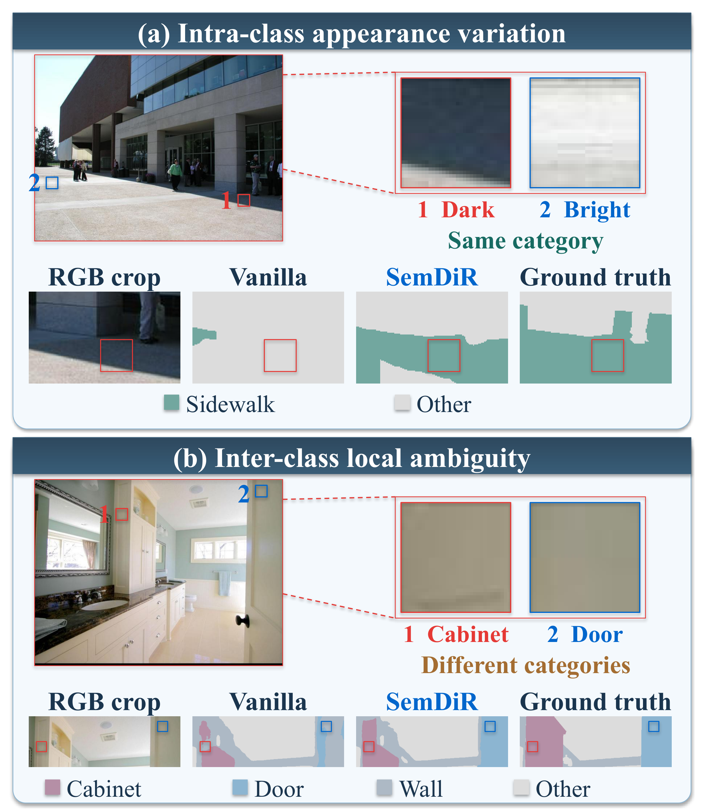
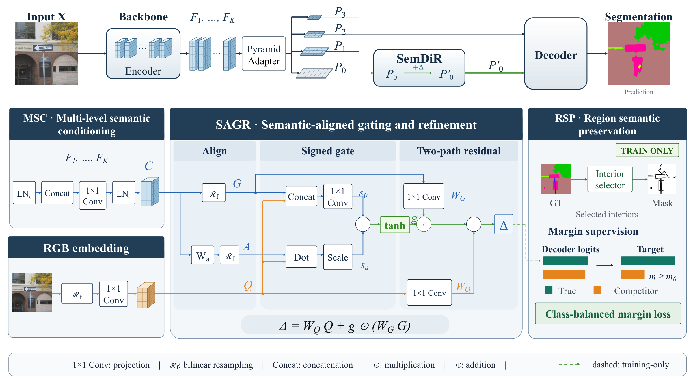
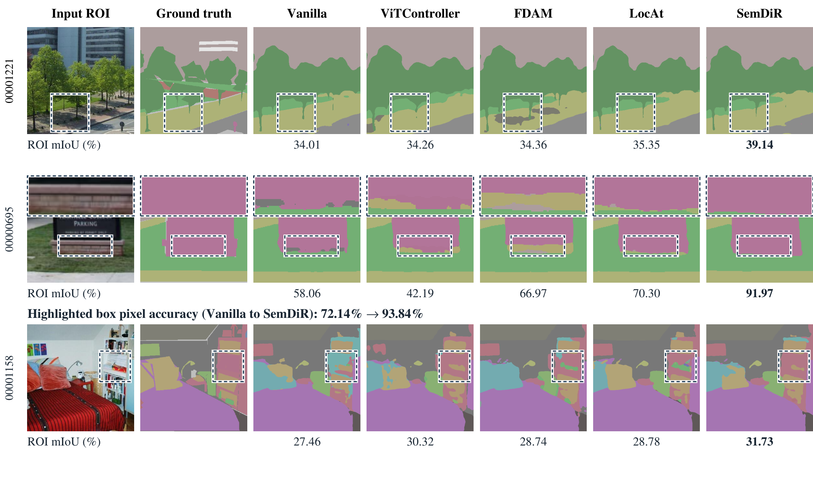

# SemDiR: Compact Semantic Context for Fine-Grid Refinement

[English](README.md) | **简体中文**

SemDiR 面向语义分割中的局部类别歧义，在现有特征金字塔与解码器之间加入紧凑的语义引导细化模块。当前完整实现 **SemDiR-A2 = MSC + SAGR + RSP**：聚合多层语义信息，用局部 RGB 信息调节有符号语义校正，并在训练时通过区域内部监督加强类别判别。

本仓库包含源代码、实验配置、必要的依赖源码、许可证，以及论文的展示图和主表；不包含数据集、预训练权重、训练权重或完整实验日志。下表为当前论文报告的结果，本次代码整理没有重新训练或独立验证性能。

## 动机：局部外观不足以确定语义



**图 1.** 同类别的外观变化与不同类别之间的局部外观相似都可能造成分割歧义。图中展示明暗人行道以及外观相似的柜体与门；在所选区域中，SemDiR 的预测与标注一致。[PDF 原图](assets/figure1_motivation.pdf)

## 方法：紧凑语义上下文引导细网格细化



**图 2.** MSC 在粗网格上压缩多层语义特征；SAGR 将其与局部 RGB 对齐，以有符号空间门控调节语义校正，并叠加独立的 RGB 更新；仅细化最高分辨率的金字塔特征。RSP 仅在训练期间对选定区域内部施加类别均衡的 margin 监督。[PDF 原图](assets/figure2_framework.pdf)

## 效果图



**图 3.** ADE20K 上三个选定区域的定性对比，采用 DeiT-S/16、160K 训练检查点。各列依次为输入、标注、Vanilla、ViTController、FDAM、LocAt 和 SemDiR；匹配框对应相同位置。预测下方数字为整个 ROI 的 mIoU，第二行的像素准确率注释仅针对高亮框。每个方法使用一个诊断检查点，案例和窗口经过选择。[PDF 原图](assets/figure3_results.pdf)

## 主表：ADE20K，160K 训练

准确率为种子 0、1、2 的均值；SS/MS 表示单尺度/多尺度评估，粗体表示同骨干内最佳准确率。参数量包含辅助头；M/G 表示百万/十亿。FLOPs 统计支持的 512 × 2048 输入算子，一次乘加计为一次操作。对比方法的结果来自本地适配实现，Vanilla 不含 SemDiR。

| Backbone | Method | Params (M) | FLOPs (G) | mIoU SS (%) | mIoU MS (%) | mAcc SS (%) | mAcc MS (%) |
|---|---|---:|---:|---:|---:|---:|---:|
| DeiT-S/16 | Vanilla | 53.55 | 958.57 | 42.93 | 43.72 | 55.87 | 55.55 |
| DeiT-S/16 | ViTController | 53.55 | 958.57 | 45.25 | 45.66 | 56.11 | 55.41 |
| DeiT-S/16 | FDAM | 54.13 | 1113.57 | 45.49 | 45.83 | 56.21 | 55.56 |
| DeiT-S/16 | LocAt | 53.55 | 958.63 | 45.61 | 45.88 | 56.60 | 55.67 |
| DeiT-S/16 | SemDiR (ours) | 53.62 | 960.44 | **45.99** | **46.63** | **57.47** | **56.90** |
| Swin-T | Vanilla | 59.94 | 945.66 | 44.83 | 45.98 | 53.86 | 54.03 |
| Swin-T | ViTController | 59.94 | 945.72 | 44.67 | 45.76 | 54.91 | 55.39 |
| Swin-T | FDAM | 60.64 | 946.31 | 45.37 | 46.20 | 55.77 | 55.84 |
| Swin-T | LocAt | 59.94 | 945.76 | 45.38 | 46.35 | 55.89 | 56.08 |
| Swin-T | SemDiR (ours) | 60.00 | 946.36 | **45.86** | **46.85** | **56.42** | **56.88** |
| MiT-B0 | Vanilla | 31.60 | 865.52 | 40.81 | 41.16 | 51.77 | 50.73 |
| MiT-B0 | ViTController | 31.60 | 865.54 | 40.24 | 41.06 | 51.35 | 50.47 |
| MiT-B0 | FDAM | 31.71 | 849.56 | 40.94 | 41.24 | 51.80 | 50.68 |
| MiT-B0 | LocAt | 31.60 | 848.91 | 40.22 | 40.89 | 50.95 | 50.31 |
| MiT-B0 | SemDiR (ours) | 31.62 | 865.78 | **41.08** | **41.70** | **52.82** | **51.90** |

DeiT-S/16 上，SemDiR 相对 Vanilla 的 SS/MS mIoU 分别提升 3.06/2.91 个百分点。完整 LaTeX 表格见 [Table 1 源文件](assets/table1_main.tex)。这些汇总均值与下方源码包的单种子 recipe 范围不同；发布配置本身不代表包含三种子运行记录或已完成性能复现。

## 代码导航

| 内容 | 路径 |
|---|---|
| 主方法 DeiT-S / ADE20K 160K | `configs/main/ade20k_deit_s.py` |
| 主方法前向、Q 与 gG 残差更新 | `src/competitors/direct_second.py::DirectNoFineRelay` |
| MSC 的四层条件聚合与共享模型基类 | `src/competitors/semdir_direct.py` |
| Swin-T / MiT-B0 泛化 | `src/competitors/semdir_a2_main.py`、`semdir_direct_swin.py`、`semdir_direct_generalization.py` |
| 跨骨干配置 | `configs/generalization/backbones/` |
| Context59 / COCO-Stuff-10K 泛化 | `src/competitors/semdir_a2_datasets.py` |
| CamVid11 泛化和数据集定义 | `src/competitors/semdir_a2_camvid.py`、`semdir_direct_camvid.py` |
| 跨数据集配置 | `configs/generalization/datasets/` |
| C0 / C1 | `src/competitors/semdir_a2_additive.py` |
| C2，无 RSP | `src/competitors/semdir_a2_cumulative.py` |
| C3，完整主方法的 20K 消融参照 | `src/competitors/direct_second.py` |
| D1，去语义点积；D2，仅 F12 条件 | `src/competitors/semdir_a2_controls.py` |
| RGB-only、全局门控、无门控、门控激活、RSP-only 等机制消融 | `src/competitors/semdir_mechanism.py` |
| 所有消融配置 | `configs/ablations/` |
| RSP 区域筛选 | `src/research/ad_pcpf_v2/regions.py::ordinary_interior_mask` |
| RSP 类别均衡 margin 损失 | `src/research/ad_pcpf_v2/loss.py::region_semantic_margin` |
| 分割器训练损失 | `src/research/ad_pcpf_v2/adapter.py::ADPCPFRegionPreservingSegmentor` |
| 训练、评估和配置检查入口 | `tools/run.py` |
| 实验索引，无指标或实验产物 | `experiment_index.py` |

主方法仅更新最高分辨率金字塔特征：

```text
C = LayerNorm(Conv1x1(Concat(ChannelLN(F3), ..., ChannelLN(F12))))
Q = Conv1x1(Resize(normalized_RGB))
G = Resize(C)
g = tanh(Wg[G,Q] + sum(Resize(Wa(C)) * Q) / sqrt(32))
P0_new = P0 + Wout[Q, g*G]
```

Q 不经过门控。完整主方法不含 beta、Vf、gamma。RSP 仅在训练期使用 GT：margin=0.5，边界半径3，排除面积≤画布0.5%的同类8连通区域，类别均衡；前10K步线性增加权重至0.05。

## 发布配置范围

- ADE20K 主方法及 Swin-T、MiT-B0：完整160K训练，seed1。
- Context59、COCO-Stuff-10K、CamVid11：从 ImageNet 独立初始化，80K训练，seed1。
- C0–C3、D1/D2及大部分机制消融：停止于20K，保留160K学习率曲线。`mechanism-no_rsp_160k` 是单独的完整160K无RSP控制。
- C0=Vanilla；C1=+MSC；C2=+MSC+SAGR；C3=完整SemDiR（+RSP）。
- 全局门控消融中的标量 beta 仅属于该消融，不属于完整主方法。
- 源码和配置不等同于某项实验已经完成；论文报告的汇总成绩见上方主表，原始运行产物未随仓库发布。

## 环境

使用 Python 3.11 和匹配的 PyTorch / torchvision。项目使用 PyTorch 2.10、MMEngine 0.10.7、MMCV 2.1 的接口。安装 `requirements.txt` 的 Python 依赖，并安装与本机 PyTorch/CUDA 匹配、包含 ops 的 MMCV 2.1.0。编译产物没有打包。

`src/timm` 和 `src/mmsegmentation/mmseg` 是本项目使用的本地依赖版本，入口优先加载它们。MMSeg tokenizer 的词表是导入所需的依赖资源，随源码保留；它不是实验数据集或输出。第三方许可和授权说明在 `licenses/`，源文件原版权标识保留。

## 外部输入

权重和数据需放在代码包外部。配置中的 `${DATA_ROOT}`、`${PRETRAIN_ROOT}` 由运行入口替换；预训练文件名见 `python tools/run.py list` 对应的 `experiment_index.py`。保留原预训练 SHA256 检查，不用训练权重代替 ImageNet 初始化。

数据布局由配置指定：

- ADE20K：`images/{training,validation}`、`annotations/{training,validation}`；标签0忽略，1..150为类别。
- Context59：`JPEGImages`、`SegmentationClassContext`、`ImageSets/SegmentationContext/{train,val}.txt`；reduce-zero一次。
- COCO-Stuff-10K：`images/{train2014,test2014}`、`annotations/{train2014,test2014}`；使用已按官方 converter 转换的标签，0忽略、1..171为类别。
- CamVid：`CamVid_RGB`、`CamVidGray`、`splits/{train,val,test}.txt`；Sky=0有效，禁止reduce-zero。训练367、验证101、测试233。

## 使用

```bash
# 列出实验；这一步不加载模型，不需要数据或权重
python tools/run.py list

# 查看解析后的配置；不会训练
python tools/run.py inspect main-ade-deit \
  --data-root /path/to/ADEChallengeData2016 --pretrain-root /path/to/pretrained

# 检查配置和模型/数据集注册；不会训练
python tools/run.py check ablation-c3

# 在新的外部输出目录训练。4卡×每卡4张=global16
# 首次在新环境运行，先完成独立的真实数据200步smoke并检查损失/梯度，再启动正式训练。
torchrun --standalone --nproc-per-node=4 tools/run.py train main-ade-deit \
  --launcher pytorch --data-root /path/to/ADEChallengeData2016 \
  --pretrain-root /path/to/pretrained --batch-size 4 \
  --work-dir /path/to/new_runs/main-ade-deit --execute

# 单尺度评估，使用外部训练checkpoint
python tools/run.py test main-ade-deit \
  --data-root /path/to/ADEChallengeData2016 --pretrain-root /path/to/pretrained \
  --checkpoint /path/to/checkpoint.pth --work-dir /path/to/new_evaluation --execute
```

替换实验别名即可运行泛化或消融。每个消融独立训练，不通过在已训练模型上删除模块代替。`check` 仅检查配置/注册，不代表完成训练验收或性能复现。

## 导出方式与兼容代码

模型和损失源文件按本地依赖闭包原样保留，未重写计算图或改动模块初始化顺序。因原生构造器、注册器之间存在引用，共享兼容目录包含部分较早命名的实现；应按上方导航定位当前主方法。

本包的配置从现有 Python recipe 中提取模型、数据变换、优化器及训练计划；去掉历史 `paper` 记录、输出目录、结果引用和依赖历史 study 的审计 hook，替换为包内 `SemDiRIterationHook`，以原来的 `runner.iter + 1` 更新 RSP warm-up 时钟。模型、损失、数据协议和训练预算保留。原工程审计函数仅作为原始依赖源码保留，不是本包运行入口；没有复制或伪造任何历史 smoke 回执、初始化证明或封存文件。

本包未重新训练；不要将代码整理视作新的性能验证。
